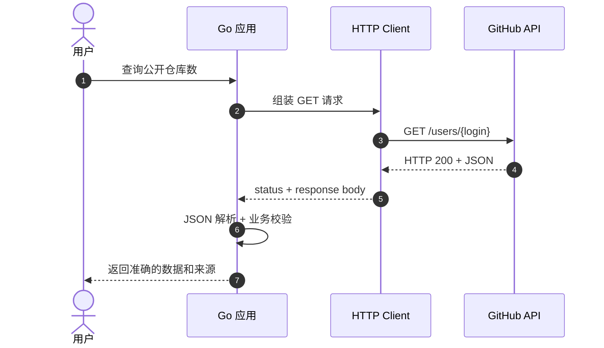
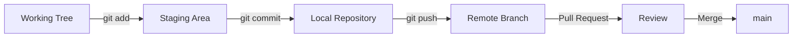

# 00 · Foundations｜Go Agent 开发前的工程基础

> **这一章不教你造 Agent，而是确保你能看懂 Agent 如何与外部世界通信。**  
> 学习顺序：建立直觉 → 识别边界 → HTTP/JSON 实践 → Git 工作流 → 安全测试 → 扩展思考。

| 学习导航 | 内容 |
| :--- | :--- |
| 前置要求 | Go 基础语法、能使用终端；如果已经熟悉可直接做自测 |
| 预计投入 | 2–4 小时（熟练 Go/Git 的开发者可跳读） |
| 产出 | GitHub Profile Go CLI、`httptest` 单元测试、一次本地 Git commit |
| 配套目录 | [`../examples/stage-00/`](../examples/stage-00/)（独立 Go module：`github` 包 + `main.go`） |
| 原文 | [Stage 00 · Foundations](https://github.com/WenyuChiou/awesome-agentic-ai-zh/blob/main/stages/00-foundations.zh-Hans.md) |

> **版本与定位**：这是面向 Go 开发者的独立学习笔记。原课程的入门实践用 Python；这里用 Go 标准库重新实现，不是逐行翻译。CLI 与 Git 知识具有通用性；具体云服务接口仍以相应官方文档为准。

## 学习完成后，你应该能回答

- API、HTTP、JSON 三者分别是什么，为什么不能混为一谈？
- 为什么模型调用、工具调用、MCP Server 之间都需要传输协议和数据格式？
- 为什么 `http.Client.Timeout`、HTTP 状态码与 JSON 字段验证都不能省？
- 为什么程序在本地 `git commit` 之后，GitHub 上还没有变化？
- 为什么 Token 不能出现在仓库、日志、报错详情或截图里？

---

## 01 · 用一张图建立全局直觉

你给 Agent 一句话：“查询某个 GitHub 用户有多少公开仓库”。



在这张图里：**Go 程序负责真实的 HTTP 请求，GitHub API 提供数据，JSON 是传输的结构化表示。** 下一章的 LLM API 与第三章的 Tool Use 都建立在这一层之上。

### 一眼认清常见术语

| 概念 | 直觉理解 | Go 中对应什么 |
| --- | --- | --- |
| Terminal | 运行程序的窗口 | macOS Terminal / iTerm2 |
| Shell | 解释你输入的指令 | `zsh`, `bash` |
| CLI | 供人通过文本使用的软件入口 | `flag`, `os.Args`, `fmt` |
| API | 一个软件对外声明的调用契约 | `net/http` / gRPC / Go interface |
| HTTP | 网络请求与响应的一组规则 | `http.Client`, `http.Request` |
| JSON | 传输结构化数据的文本形式 | `encoding/json` |
| YAML | 常见的配置序列化格式 | 标准库**不**内置 YAML 解析器 |
| Git | 分布式版本控制系统 | `git` 命令 |
| GitHub | 托管 Git 仓库和协作流程的平台 | Pull Request、Issue、Actions |
| API Token | 向服务证明身份的凭据 | 环境变量 / Secret Manager |

> **容易混淆的一点**：API 不等于 HTTP。Go 的接口 `type Store interface { Save(...) }` 也是 API；HTTP 只是远程 API 的一种常用实现方式。

## 02 · HTTP 到底在交换什么？

一个 HTTP 请求大致由 Method、URL、Headers、Body 组成。响应由 Status、Headers、Body 组成。

```http
GET /users/torvalds HTTP/1.1
Host: api.github.com
Accept: application/vnd.github+json
User-Agent: agentic-go-foundations-study
```

返回可能包含（下方是**教学示意值**，不是实时 GitHub 数据）：

```json
{
  "login": "example-user",
  "followers": 42,
  "public_repos": 8
}
```

### 为什么 Go 要先看状态码？

`json.Decoder` 只知道 Body 能不能被解析。它不知道请求是成功，还是收到了 `401 Unauthorized` / `403 Forbidden` / `404 Not Found` / `429 Too Many Requests`。**有效 JSON ≠ 业务成功。**

| 响应状态 | 含义 | 你的程序应该怎么做 |
| --- | --- | --- |
| 200 | 请求正常完成 | 再解析并验证字段 |
| 401 | 未提供或提供了无效凭据 | 诊断认证，不盲目 retry |
| 403 | 权限不足或访问受限 | 检查权限、政策与限流信息 |
| 404 | 资源不存在 | 返回明确的不存在错误 |
| 429 | 请求次数超限 | 根据服务端建议进行**有上限**的重试 |
| 500/503 | 服务端异常 | 记录与有限重试，必要时快速失败 |

### 数据形状和数据意义是两层校验

```go
// examples/stage-00/github/github.go
// Profile 字段与 GitHub API JSON 一一对应。
type Profile struct {
    Login       string `json:"login"`
    Name        string `json:"name"`
    PublicRepos int    `json:"public_repos"`
    Followers   int    `json:"followers"`
}
```

`encoding/json` 帮你检查数据能否写入这些 Go 字段，但你还应检查用户名非空、数字没有异常，以及是否读到了预期资源。**Schema Valid ≠ Semantic Valid。**

## 03 · Go 实践：写一个 GitHub Profile CLI

### 第一步：阅读最小调用链

完整代码：[`examples/stage-00/github/github.go`](../examples/stage-00/github/github.go)

```go
client := &http.Client{Timeout: 10 * time.Second}
ctx, cancel := context.WithTimeout(context.Background(), 10*time.Second)
defer cancel()

profile, err := github.FetchProfile(
    ctx, client, "https://api.github.com", *login,
)
if err != nil {
    log.Fatal(err)
}

res := github.Summary(profile)
if err := github.WriteSummary(*out, res); err != nil {
    log.Fatal(err)
}

fmt.Println(res)
fmt.Println(*out)
```

以上是调用示意；可直接运行的完整 `main` 在 [`examples/stage-00/main.go`](../examples/stage-00/main.go)。

注意三个设计选择：

1. **注入** `*http.Client`：可以用 `httptest` 替换真实服务器，测试时不联网。
2. **注入** `context.Context`：上游取消任务时，不必等所有网络操作自然结束。
3. **固定真实域名**：真实 CLI 不从用户输入任意拼接可访问的 URL；测试用 `baseURL` 注入只是为了替身服务器。

### 第二步：运行离线测试

`examples/stage-00` 是一个独立的 Go module（模块名 `stage-00`，仓库根目录没有 `go.mod`），所以先进入该目录再执行：

```bash
cd examples/stage-00
go test ./github -v    # 或 go test ./... -v
```

配套测试覆盖：正常 JSON、异常状态码、不可解析 JSON、缺失字段、过大的响应、无效用户名、取消以及本地结果文件。

### 第三步：可选地真实访问 GitHub API

只有这一条命令需要网络（同样在 `examples/stage-00` 目录下执行）：

```bash
go run . -user torvalds -out result.txt
```

不带参数时，默认查询 `leehainuo` 并写入 `result.txt`。命令会输出实时结果，并把只包含公开摘要的文字写到 `result.txt`。关注者数量会变化，因此**不要在测试里写死实时数字**。访问公开用户数据不需要 GitHub Token，但仍受 GitHub 的访问和限流规则约束。

`WriteSummary` 通过临时文件 + `rename` 原子替换结果文件，并以 `0600` 权限写入；只序列化公开摘要，不落任何凭据。

### 第四步：写出为什么不用直接 `http.Get`

```go
resp, err := http.Get("https://api.github.com/users/torvalds")
```

这在小例子里很短，但失去了对**每次请求 Context** 与专属 **Timeout / 测试 Client** 的显式控制。我们不用“短”作为唯一判断标准，而是在可维护性、正确性和复杂度之间找到合适边界。

## 04 · JSON 与 YAML：不要让格式变成系统设计

```json
{
  "model": "local-model",
  "temperature": 0.2,
  "enabled": true,
  "tools": ["search", "calculator"]
}
```

等价的 YAML 配置大概长这样：

```yaml
model: local-model
temperature: 0.2
enabled: true
tools:
  - search
  - calculator
```

这里要注意：

- JSON 适合大量 API 调用，并且 Go 标准库已有良好支持。
- YAML 常用在 Kubernetes、CI/CD 和人工维护的配置中，但标准库没有内置 YAML parser，真实使用需额外依赖并确认解析规则。
- 配置文件能限制数据**形状**，不代表自动获得访问控制或隐私保护。
- 密钥不应直接写在会提交的配置中，可以用环境变量或专用密钥管理系统。

## 05 · Git：工程开发不是单纯保存文件



`git add` **选中这次修改，**`git commit` **留下本地快照，**`git push` **才会上传远程；PR 的创建与合并又是不同的动作。**

### 推荐用一个练习分支记录成果

```bash
git status
git switch -c docs/stage-00-foundations

git add docs/00-Foundations.md examples/stage-00
git commit -m "docs: add stage-00 foundations notes and example"

# 仅在已连接并核对远程仓库时执行
git remote -v
git push -u origin docs/stage-00-foundations
```

若你在单独解压的资料包中操作，文件路径以实际目录为准。若仓库还没有 Git 初始化，可以先 `git init`，再检查默认分支和远程配置。

**重要概念**：Fork 是远端仓库副本；Branch 是版本历史中的开发分支；Pull Request 是希望另一分支接受修改的协作提案。GitHub `Closed` 的 Issue/PR 不一定意味着变更已合并。

## 06 · 为什么你应该在 Stage 00 就学会测试 HTTP？

```go
// 示例展示模式；完整实现见 github_test.go
server := httptest.NewServer(http.HandlerFunc(func(w http.ResponseWriter, r *http.Request) {
    w.Header().Set("Content-Type", "application/json")
    _, _ = w.Write([]byte(`{"login":"gopher","followers":12,"public_repos":5}`))
}))
defer server.Close()

// 把 server.Client() 与 server.URL 传进被测函数。
```

使用 `httptest` 的好处：不会因为网络波动导致测试失败；可以构造真实服务不容易稳定复现的 `429`、超时、坏 JSON；还能准确检查 HTTP Method、Path、Header 和错误处理。

但也要知道：**mock 测试通过不等于真实 GitHub 的 API 行为已经集成验证**。上线前仍应在受控环境做一轮端到端验证。

### 五条必须记住的安全底线

1. **凭据不提交**：`.env`、Token、Cloud Key 不应写进 Git 版本历史；`.gitignore` 不能替代提交前检查。
2. **URL 有信任边界**：生产服务不能让普通用户随意填写目标 URL 后由服务器请求；否则可能造成 SSRF。
3. **Body 有长度上限**：避免远端返回无限流或巨型 JSON，让内存不受控。
4. **Timeout + Cancel**：网络调用必须可以结束，不让程序永久卡死。
5. **错误不泄密**：日志中避免记录 Authorization、用户私密数据或未脱敏请求体。

---

## 07 · 扩展思考：从“会用 API”到“会设计 API”

### 思考 A：为什么 `http.Client` 往往应该被复用？

展开提示（先自己回答）

`http.Client` 是可并发复用的，内部 Transport 能复用连接。每次请求创建一个 Client/Transport 可能浪费连接资源；但 Timeout、代理和 TLS 策略不同的场景也可能需要专门实例。

**我的解释**：

> _在这里用 3–5 句话回答。_

### 思考 B：如果 API 调用成功，但解析返回 JSON 失败，能否直接无限重试？

请分别讨论：请求是否有副作用、JSON 是否来自稳定契约、重试预算、告警与回退策略。对于写操作还要讨论幂等键。

**我设计的失败策略**：

> _我的决策、理由、停止条件和验证方法。_

### 思考 C：为什么一个 Agent 工具对外给出的 JSON 不能代替真正的权限控制？

在下一阶段的 Tool Use 中，Schema 是请求契约，而**工具执行器**仍必须验证权限和业务规则。请用“删除仓库 Issue”设计一个不能被模型自行批准的控制流程。

### 思考 D：Go 标准库优先是否意味着所有依赖都是坏的？

不是。记录引入 YAML、数据库、OpenTelemetry、Ollama SDK 等依赖时的收益、维护成本和替代方案。标准库优先是一种**审慎的默认选择**，不是拒绝生态。

## 08 · 学习实验与 DIVE 复盘

| 实验 | 先写预测 | 运行后证据 | 我的解释 |
| --- | --- | --- | --- |
| 正常响应变 `429` | 程序会怎么处理？ | `TestFetchProfileFailures` | ______ |
| 返回无效 JSON | 错误应在哪层出现？ | `TestFetchProfileFailures` | ______ |
| 请求提前取消 | 能否快速结束？ | `TestFetchProfileInvalidInputAndCancel` | ______ |
| Body 超过限制 | 如何防止资源耗尽？ | `TestFetchProfileFailures` | ______ |

**D — Design**：我区分了哪些协议和业务边界？

> ______

**I — Implement**：我写的 `Client` 和 Profile 类型是否过度抽象？

> ______

**V — Verify**：除了成功路径，我主动验证了哪种失败？

> ______

**E — Evolve**：迁移到 Stage 01 的模型 API 时，我会复用哪一层设计？

> ______

## 09 · 进入下一阶段之前

- [ ] 我能在 `examples/stage-00` 目录运行 `go test ./github -v` 且全部通过。
- [ ] 我说得出 HTTP 状态检查、JSON 解析和业务验证的三层职责。
- [ ] 我能解释 Context、Timeout、响应大小限制解决什么问题。
- [ ] 我知道 Git 分支、Commit、Push、PR 的区别。
- [ ] 我能在代码、提交记录与日志中排除 Token 泄露。

完成后进入 [01 · LLM Basics](./01-LLM-Basics.md)。

### 推荐进一步阅读

- [Go 官方：A Tour of Go](https://go.dev/tour/)
- [Go 官方：Effective Go](https://go.dev/doc/effective_go)
- [Go 官方：net/http](https://pkg.go.dev/net/http)
- [Go 官方：encoding/json](https://pkg.go.dev/encoding/json)
- [Git 官方：Pro Git](https://git-scm.com/book/en/v2)
- [GitHub Docs：Hello World](https://docs.github.com/en/get-started/start-your-journey/hello-world)
- [GitHub REST API：Users](https://docs.github.com/en/rest/users/users)

> **本章一句话**：学 Agent 之前，先掌握“请求如何发出去、数据如何被验证、失败如何被控制、修改如何被追溯”。
