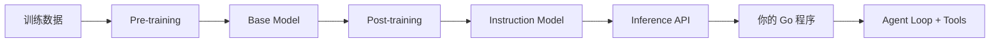
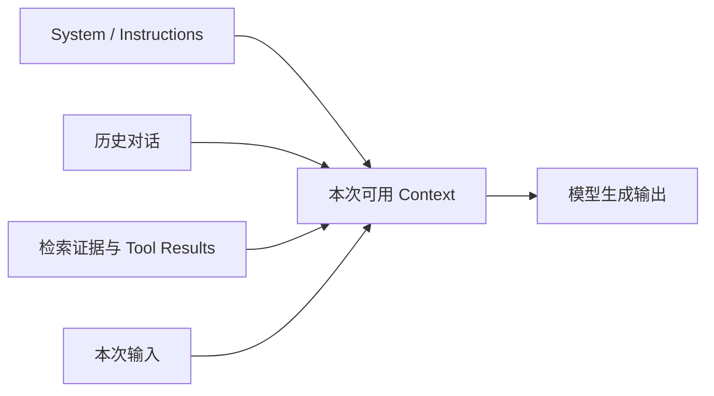
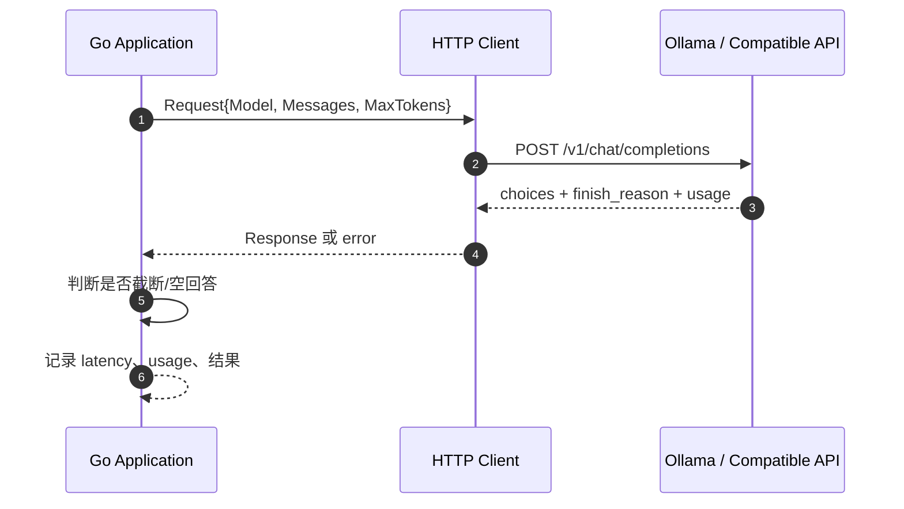
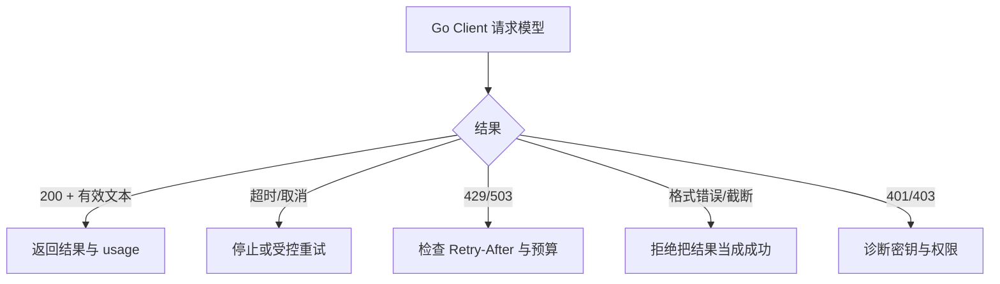

# 01 · LLM Basics｜用 Go 理解模型与 API

> **模型不是魔法；它是一个接受上下文、生成输出的计算系统。**  
> 学习路径：直觉 → 模型生命周期 → Token/Context/Temperature → Go HTTP 调用 → Usage/成本/延迟 → 评测与扩展思考。

| 学习导航 | 内容 |
| :--- | :--- |
| 前置 | [00 · Foundations](./00-Foundations.md)，Go `net/http` 与 `encoding/json` |
| 核心成果 | 一个可 Mock、可接 Ollama、能读取 Usage 的 Go LLM Client |
| 配套源码 | [`../examples/stage-01/`](../examples/stage-01/) |
| 练习入口 | `cd examples/stage-01` 后执行 `go test ./llm -v` / `go run . -mode mock` |
| 来源 | [Stage 01 · LLM Basics](https://github.com/WenyuChiou/awesome-agentic-ai-zh/blob/main/stages/01-llm-basics.zh-Hans.md) |

> 本章使用 Go 标准库与 OpenAI-compatible Chat Completions JSON 协议做教学实现。`mock` 与 `ollama` 是两条不同路径，离线 Mock 数据不能用于评价真实模型的输出质量。实际可用模型标签、上下文上限、参数与价格须以调用当天的提供方文档为准。

## 学习目标

- 解释模型是怎样从预训练变成可调用的指令模型。
- 区分 Token、Tokenizer、Context Window、Max Output、Temperature。
- 用 Go 构造一轮 Chat Completion 请求并解析 `choices` / `usage`。
- 将模型 API 与自己开发的 Agent Runtime 分层。
- 用固定测试来对比不同模型的正确率、延迟和成本，而不是凭直觉选型号。

---

## 01 · 模型从哪里来？



| 名称 | 发生在什么时候 | 你需要抓住什么 |
| --- | --- | --- |
| Pre-training（预训练） | 模型开发阶段 | 从大规模数据中学习统计模式和表征 |
| Post-training（后训练） | 预训练之后 | 优化指令遵循、偏好对齐和某些任务表现 |
| SFT / DPO / RLHF | 训练技术 | 不用先实现它们，也可以开发 Agent |
| Inference（推理） | 你请求模型的时候 | 使用已有权重产生输出，不等于训练 |
| Fine-tuning（微调） | 专项训练阶段 | 改变模型参数；不等于把最新文档塞入上下文 |
| RAG | 请求前的检索阶段 | 找外部证据，通常不改模型参数 |
| Agent | 模型外部的运行系统 | 模型提出计划或动作，程序控制工具和停止条件 |

**重要结论**：Agent 不是“更高级的模型版本”。它通常是一套围绕模型运行的**工具、上下文、状态、权限和控制循环**。

### 用一个产品场景建立直觉

例如你要构建“帮助开发者解释 GitHub PR 的 Go 助理”：

- LLM：帮助理解用户意图、描述代码问题。
- RAG：从项目 README、代码规范或文档中检索事实。
- Tool Use：读取 PR Diff、查询 CI、提交评论。
- Workflow：先审查再人工批准，最后才写入评论。
- Harness：限制次数、时间、费用和危险动作。

模型不能直接代替这些工程边界。后面的 Stage 03–08 会分别落实。

## 02 · 三个必须彻底理解的概念

### 2.1 Token：不是字数，也不是字符数

Token 是模型处理的文本单元（对于多模态模型，还可能存在不同的计量方式）。模型使用自己的 Tokenizer 将输入映射成 Token IDs。

假设你看到两句：

```text
Go is simple.
Go 语言注重简单与组合。
```

它们的 Token 数**不能单靠中英文字符数量确定**。不同 Tokenizer 的分段不同，甚至同一个字符序列也可能被拆成不一样的 token。要记录真实调用，应优先读取提供商实际返回的 `usage`。

```go
// 来自 examples/stage-01/llm/client.go。
type Usage struct {
    PromptTokens     int `json:"prompt_tokens"`
    CompletionTokens int `json:"completion_tokens"`
    TotalTokens      int `json:"total_tokens"`
}
```

> 注意：`usage` 是服务端报告的消耗；其是否包含缓存、推理 token 或多模态类别，取决于具体 API。不要把所有服务商的字段当作完全一致。

### 2.2 Context Window：不是无限长度的聊天记忆



**上下文窗口**限定本次推理模型能处理的 token 范围，历史消息、工具结果和输入材料会占用这个范围。输出容量还受提供方单独的最大生成长度限制；思考模式等功能也可能改变预算计算。

问自己：“我把 20 份日志都塞进去，模型真的更好了吗？”不一定。更大的上下文可能增加成本、干扰、延迟；有时**更好的检索与摘要**比盲目扩容更有效。

### 2.3 Temperature：控制采样，不控制真相

对于**支持该参数**的模型与接口，较低 Temperature 通常使输出倾向于高概率候选；较高值通常增加采样多样性。它不增加知识，不保证低值绝对确定，也不能取代固定格式约束或 Eval。

| 任务 | 初步倾向 | 真正需要验证的是什么 |
| --- | --- | --- |
| 提取结构化字段 | 较低采样随机性 | JSON 合法率、字段准确率 |
| 客服分类 | 稳定、一致 | 分类准确率和非法标签率 |
| 写多个创意标题 | 更宽的采样 | 多样性与符合要求的比例 |
| 工具调用 | 稳定、遵循 schema | 选对工具、参数合法、不会乱操作 |

**部分推理模型不接受 `temperature`、`top_p` 等参数**，也有模型会覆盖或忽略兼容接口参数。不要因为文档里有这个字段就认为每个模型都能用。

## 03 · Go 里一次模型调用到底经历什么？



### 对应的 Go 数据结构

完整代码在 [`examples/stage-01/llm/client.go`](../examples/stage-01/llm/client.go)。

```go
type Message struct {
    Role    string `json:"role"`
    Content string `json:"content"`
}

type Request struct {
    Model       string    `json:"model"`
    Messages    []Message `json:"messages"`
    MaxTokens   int       `json:"max_tokens,omitempty"`
    Temperature *float64  `json:"temperature,omitempty"`
}
```

为何 `Temperature` 使用指针？因为 **nil 代表不传**，而数值 `0` 代表显式设置为 0。这是 Go 序列化里一个常见但容易忽略的区别。

### 核心 HTTP 实现设计

```go
// 构造请求：请求体来自 JSON，需显式指定 Content-Type。
body, err := json.Marshal(in)
if err != nil { return Response{}, err }
req, err := http.NewRequestWithContext(ctx, http.MethodPost, endpoint, bytes.NewReader(body))
if err != nil { return Response{}, err }
req.Header.Set("Content-Type", "application/json")
```

这段是 `Complete` 方法内部的节选；直接复制整段不能独立编译，完整可运行实现见源码。`ctx` 控制调用超时和取消；API Key 不应被打印到日志中。

### 为什么一定要检查 `finish_reason`？

模型有时因为长度限制而停止。若你直接把部分 JSON 作为成功结果交给下一步，就可能引入错误决策。教学客户端拒绝 `finish_reason == "length"`、空 `choices`、空文本与非法响应。

但它**不是完整 SDK**：真实 API 还可能返回 refusal、tool_calls、多模态 content、thinking blocks、streaming events 等。不同供应商也有不同响应结构，不能强行 `json.Unmarshal` 为同一个类型然后假装语义完全相同。

## 04 · 动手练习 1：先运行 Mock，再连接真实模型

### Path A：离线、无网络、无 API Key

```bash
cd examples/stage-01
go test ./llm -v
```

运行 Mock 版 CLI（注意：`main.go` 在启动时就会读取 `OLLAMA_MODEL` 环境变量，即使是 mock 模式也要求先设置，任意非空值即可）：

```bash
export OLLAMA_MODEL=mock
go run . -mode mock
```

预期看到一条带 `[Mock]` 前缀的回答、**预设**的 usage 数据（15 / 20 / 35）以及一行提醒：Mock 的 token 和响应内容都是固定测试数据。数字只是为验证代码路径而提供的假数据，不是从模型测得的。

测试覆盖：HTTP Method/Path/Authorization、JSON 解码、`429`、坏 JSON、空内容、响应截断、超时与价格公式。

### Path B：接本机 Ollama

先按 [Ollama 官方安装文档](https://docs.ollama.com/) 安装与启动，下载实际可用的模型，例如原教程使用的模型或本地已有模型。模型 tag 与参数支持需以运行时确认的列表为准。

```bash
# macOS zsh：先确认 Ollama 已启动，模型已下载
ollama list

# 可按本机已有模型设置，例如：
export OLLAMA_MODEL="qwen2.5:3b"

go run . -mode ollama \
  -prompt "请用三句话解释 Go Agent Loop 的作用"
```

默认 endpoint 是本机 `http://127.0.0.1:11434/v1`。本例不把数据发送到 OpenAI 云端；但如果你把 endpoint 换成第三方兼容服务，务必重新评估授权、网络和数据隐私。

> 本机 Ollama 不收取云端 API 费用，但模型下载、显存、硬件、电力和运行时间都不是零成本。

## 05 · 动手练习 2：理解 Usage、延迟与成本

### 5.1 成本是“输入 + 输出”而不是“总 Token × 一个单价”

假定价格分别为 `P_in` 和 `P_out`（单位：美元 / 百万 token），则：

\[
C=\frac{T_{in}\times P_{in}+T_{out}\times P_{out}}{1{,}000{,}000}
\]

Go 计算函数已经放在 [`examples/stage-01/llm/client.go`](../examples/stage-01/llm/client.go)：

```go
func EstimateCostUSD(usage Usage, rates Rates) (float64, error) {
    if usage.PromptTokens < 0 || usage.CompletionTokens < 0 || rates.InputPerMillion < 0 {
        return 0, errors.New("negative tokens or rates")
    }
    return (float64(usage.PromptTokens)*rates.InputPerMillion +
        float64(usage.CompletionTokens)*rates.OutputPerMillion) / 1_000_000, nil
}
```

留一个观察点：当前实现校验了 `InputPerMillion` 为负，但没有校验 `OutputPerMillion` 为负——负的单价会算出负的费用。把它补上是一个不错的课后练习。

举个**纯粹算术示例**：输入 2,000 tokens、输出 1,000 tokens，如果输入每百万 $1、输出每百万 $5，则一次请求费用为 `$0.007`。这不是任何特定模型的现行报价。缓存、思考/多模态 token、长上下文分段价格等需要另行建模。

### 5.2 不同延迟指标解决不同问题

| 指标 | 意义 | 适用 |
| --- | --- | --- |
| Total Latency | 发出请求直到收到完整响应 | API 体验、批处理 |
| TTFT | 第一个输出 token 的等待时间 | 流式聊天用户感知 |
| Output Tokens / s | 输出吞吐能力 | 长内容生成、硬件评估 |
| P50 / P95 / P99 | 典型与尾部延迟 | 服务 SLO 与容量规划 |

**不要用 `总输出 token / 总耗时` 假装是严格的解码吞吐**：总耗时还包括排队、预填充、网络等阶段。它只是一项粗略的端到端比值。

### 5.3 做一次有记录的模型比较

用完全相同的 6 条问题与输出规范，对两种模型各执行多次，记录：

| 指标 | Model A | Model B | 为什么重要 |
| --- | --- | --- | --- |
| 正确率（预定义 grader） | __ | __ | 能否完成业务目标 |
| 无效格式率 | __ | __ | 下游能否解析 |
| P50 / P95 延迟 | __ | __ | 稳定性与用户体验 |
| 平均输入/输出 tokens | __ | __ | 成本结构 |
| 平均费用 | __ | __ | 单次与规模化预算 |
| 错误类型 | __ | __ | 工程可用性 |

固定模型版本、参数、提示、输入数据、测试次数、硬件和系统负载。不要仅凭一次运行宣布一个模型“明显更好”。

## 06 · 实际开发必须处理的错误



实战注意：重试是工程策略，不是简单的无限循环。指数退避应有总体时限和最大次数；带副作用的请求需要幂等性；对生成内容不能只看 HTTP 200 就认定业务成功。

### 一个 Go 设计问题：为什么模型接口应该可替换？

你最终可能支持 Ollama、OpenAI-compatible Gateway、Anthropic 等。**共同的业务能力**可以在自己的应用层定义一个最小接口，provider adapter 负责处理各家的消息格式。

```go
// 设计示意：不是当前示例的完整公共接口。
type TextGenerator interface {
    Generate(ctx context.Context, messages []Message) (TextResult, error)
}
```

这种方式便于 Mock 与测试，但别过早要求所有 provider 共用完全相同的 Tool Calling、流式格式和推理参数。**统一契约必须保留能力差异，而不是掩盖差异。**

## 07 · 扩展思考（先写判断，再看资料）

### 思考 A：为什么两个相同 prompt 的输出可能不同？

考虑采样策略、模型后端实现、数值非确定性、模型更新、历史上下文、服务端随机性。Temperature 设为 0 也不一定提供严格的逐字可复现保证。

> 我的结论：______

### 思考 B：一个有 128K Context 的模型，是否一定更适合检索大量代码？

你需要同时比较检索召回、上下文相关性、成本、实际长上下文质量与输出预算。长 context 是资源，不代表模型能对所有位置一视同仁。

> 我的验证计划：______

### 思考 C：你会把模型选择逻辑放在哪里？

有两个方案：在 HTTP handler 中直接写 `if model == ...`，或者在应用层建 Model Router。比较复杂度、扩展能力、计费、安全和多租户策略；只有业务真的需要时才引入抽象。

> 我的设计选型：______

### 思考 D：为什么 `context.Context` 不能替代 Provider 预算控制？

请求超时只是控制时间；模型产生的 token 成本、重复调用次数、总任务用量需要额外统计。一个 Agent Loop 可能发起几十次请求。

> 我的控制策略：______

### 思考 E：本地模型和云端模型如何选择？

至少考虑：质量、请求时延、隐私、稳定性、支持的工具协议、硬件成本、运维成本与实际成本曲线。不要简单得出“本地必然更便宜/更安全”的结论。

> 我的权衡矩阵：______

## 08 · DIVE 实验与复盘

**D — Design**：我为模型 API 设计了什么样的职责边界？

> ______

**I — Implement**：哪些部分使用 Go 标准库？哪些能力需要将来引入 SDK？

> ______

**V — Verify**：哪些测试来自 Mock？哪些验证来自真实 Ollama？有没有误把前者当后者？

> ______

**E — Evolve**：如果之后加入 Streaming 或 Tool Calling，现有类型应该如何演进？

> ______

### 实验卡

```text
问题：____________________
假设：____________________
模型与版本：______________
固定 Prompt / Cases：_____
变量（只改一项）：________
成功指标：________________
测试次数：________________
测量结果：________________
结论与下一步：____________
```

## 09 · 自我验收

- [ ] 我可以解释 Token、Context Window、Temperature 的边界。
- [ ] 我知道训练阶段与应用推理阶段不是同一件事。
- [ ] 我在 `examples/stage-01` 目录运行了 `go test ./llm -v` 且全部通过。
- [ ] 我使用 Mock 看懂了 `choices` / `finish_reason` / `usage`，且没有把 Mock 当真实模型测试。
- [ ] 我能够根据实际 usage 和外部提供的价格计算成本。
- [ ] 我能解释不同 Provider 接口为何不能完全套用同一份 JSON 结构。

通过后进入 [02 · Prompt Engineering](./02-Prompt-Engineering.md)。

### 官方参考

- [Ollama · API Reference](https://docs.ollama.com/api/)
- [Ollama · Tool Calling](https://docs.ollama.com/capabilities/tool-calling)
- [OpenAI · Text Generation](https://developers.openai.com/api/docs/guides/text-generation)
- [Anthropic · Messages API](https://platform.claude.com/docs/en/api/messages)
- [Go · context](https://pkg.go.dev/context)
- [Go · net/http](https://pkg.go.dev/net/http)
- [Go · encoding/json](https://pkg.go.dev/encoding/json)

> **本章一句话**：模型提供概率性生成能力，Go 系统负责将它变成有边界、可观测、可测试的应用能力。
